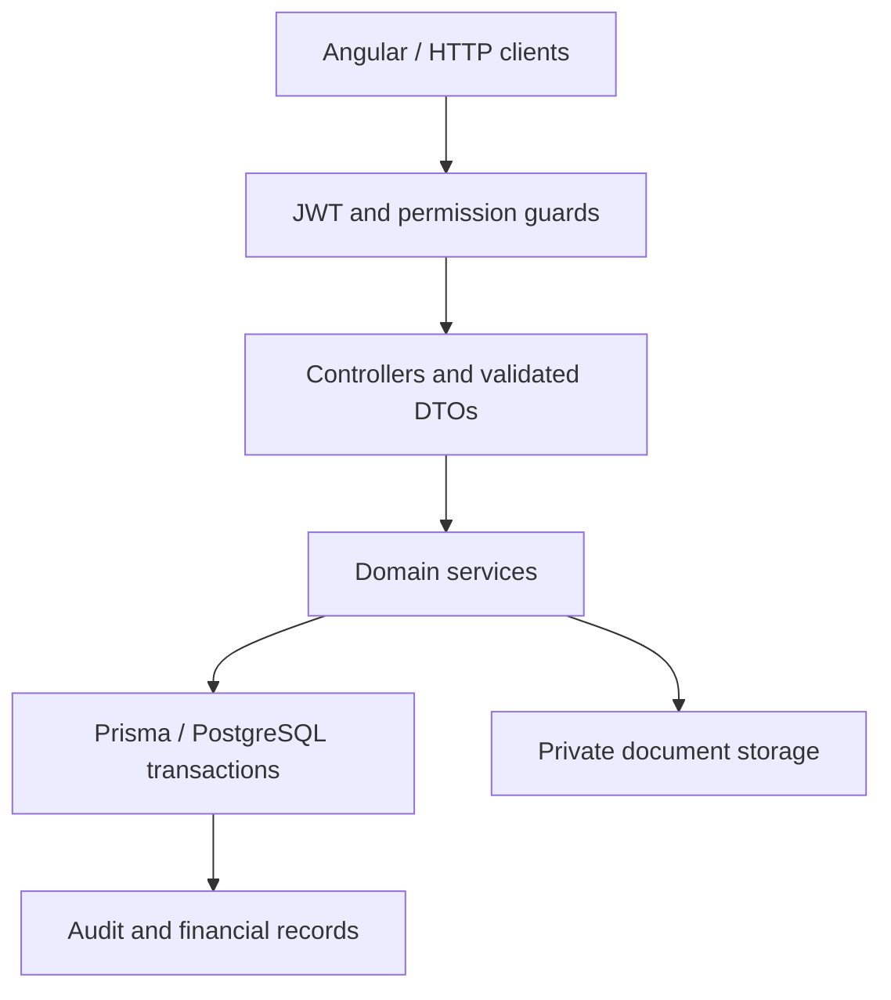

# Harpia API

A NestJS/PostgreSQL backend for tenant-scoped real-estate CRM, reservations, sales, and financial workflows.

Harpia is a development project. The [Angular client](https://github.com/macielhgustavo/harpia-web) is part of the same system, not a separate backend.

## Why this exists

Commercial workflows need consistent transitions: an accepted proposal affects a reservation, unit, opportunity, sale, and receivables. Keeping those changes authorized, auditable, and atomic is the core engineering problem.

## What it does

- Authenticates users with JWTs, active-user checks, and session versioning.
- Applies role-based permissions and organization-scoped data access.
- Connects people, opportunities, activities, visits, reservations, and proposals.
- Converts accepted proposals into sales and related financial records.
- Stores audit events and controls private document access.
- Includes collections scheduling, bank reconciliation, and financial reports.

## Architecture



Organization context comes from the authenticated user. The database and service layer remain the enforcement boundary; client-side roles are not authorization.

| Layer | Location |
| --- | --- |
| Identity, session and permissions | `src/auth/` |
| Commercial workflows | `src/crm/`, `src/reservations/`, `src/proposals/`, `src/sales/` |
| Financial workflows | `src/receivables/`, `src/collections/`, related finance modules |
| Schema and migrations | `prisma/` |
| Real HTTP/database acceptance tests | `test/` |

## Tech stack

TypeScript, NestJS, PostgreSQL, Prisma, Passport/JWT, class-validator, Jest, Supertest, and S3-compatible private storage.

## Engineering highlights

- **Fail-closed permissions:** protected handlers need explicit permission metadata or an authenticated-only declaration.
- **Session revocation:** JWT validation checks persisted token version and active user state.
- **Transactional commercial transitions:** reservation and sale paths use tenant-scoped locks, constraints, and audit records.
- **Database-backed E2E:** the test runner provisions disposable PostgreSQL, applies migrations, and exercises HTTP contracts.
- **Private documents:** local development storage and private S3-compatible production storage have separate configuration.

These patterns must be evaluated per workflow; their existence does not establish that every endpoint is free of security defects.

## Getting started

Use Node.js 22 and a local development PostgreSQL database.

```bash
git clone https://github.com/macielhgustavo/harpia-api.git
cd harpia-api
npm ci
cp .env.example .env
```

Set `DATABASE_URL` for a disposable development database and replace the example `JWT_SECRET` with a strong local value. Then:

```bash
npx prisma generate
npx prisma migrate dev
npm run start:dev
```

Use a separate database from any hosted deployment. The frontend defaults to a hosted API, so configure its endpoint separately.

## Tests

```bash
npm test -- --runInBand
npm run build
npm run test:e2e
```

The E2E runner starts disposable PostgreSQL using Docker or a local PostgreSQL installation. If `E2E_DATABASE_URL` is supplied, it must point to a test-only database: the runner resets its `public` schema. It rejects production mode, database names without test/e2e markers, and remote targets unless explicitly enabled.

GitHub Actions gates API unit tests, build, and PostgreSQL-backed E2E. The frontend has its own build and headless unit-test workflow.

## Technical decisions

- **Relational transactions over independent CRUD writes:** commercial state and audit records move together.
- **Organization as the tenancy root:** cross-organization access is checked server-side.
- **Separate frontend repository:** independently buildable client, with contract compatibility to maintain.
- **Local scheduled collections:** simple single-process scheduling today; not a durable distributed worker.

## Limitations

- The bootstrap currently reflects arbitrary CORS origins with credentials. Restrict origins before exposing an authenticated deployment.
- Collections scheduling is in-process, not a queue-backed service with distributed leases.
- Financial legacy paths and migrations need continued review; passing unit tests is not a complete accounting certification.
- No claim of customer adoption, production scale, or a security audit is made.

## Further reading

[Current CRM implementation](docs/crm.md), [engineering decisions](docs/crm/CRM_DECISIONS.md), [backlog](docs/crm/CRM_BACKLOG.md), and [progress record](PROGRESS.md).

## Roadmap

- Enforce explicit deployment CORS configuration.
- Keep the commercial E2E journey as a required regression gate.
- Publish a synthetic-data demo and concise API examples.
